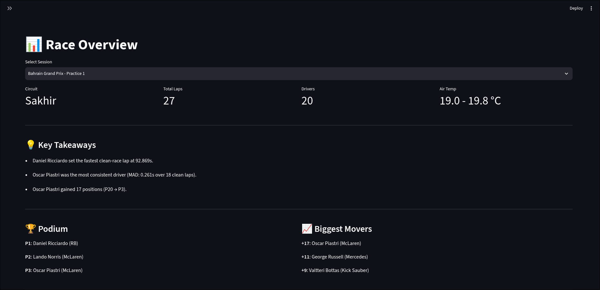
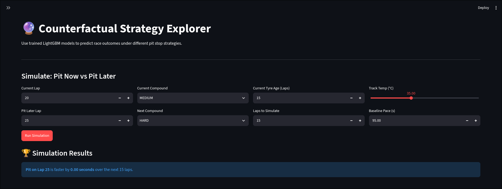
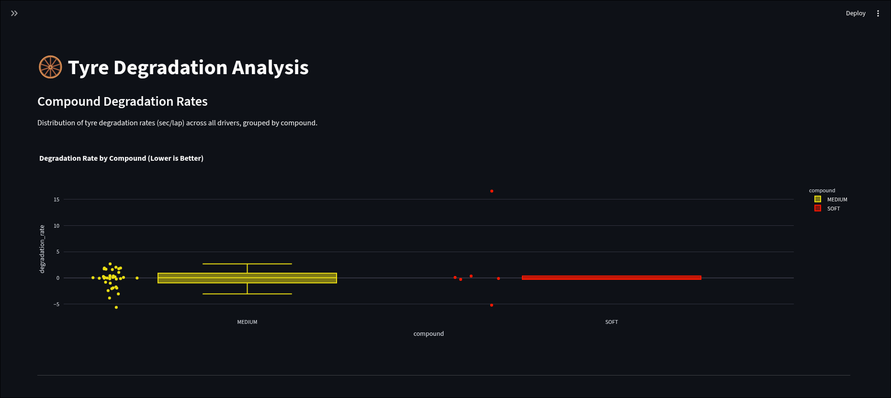
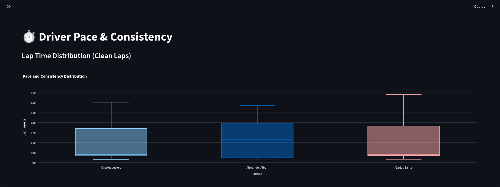
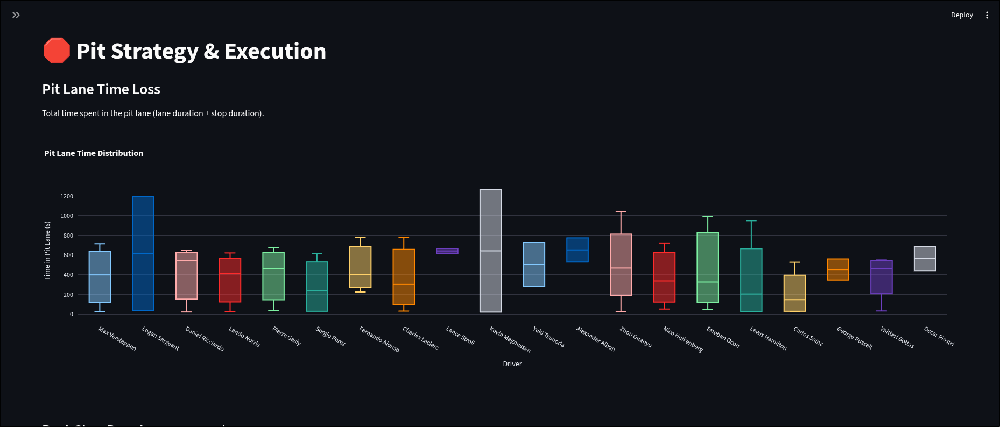
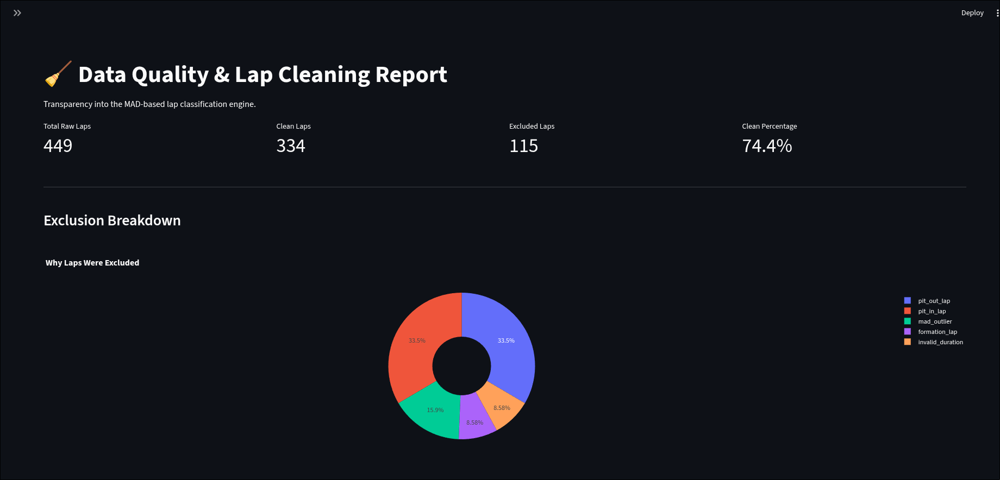
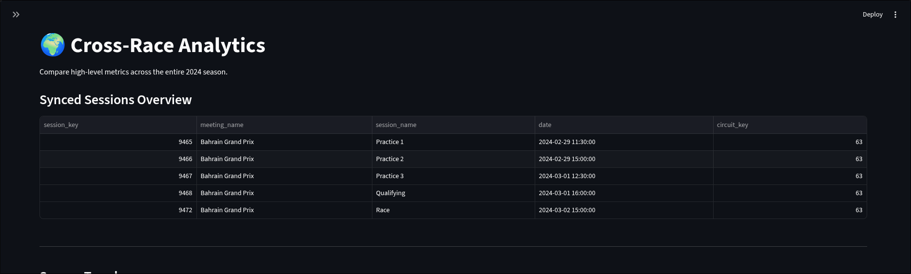
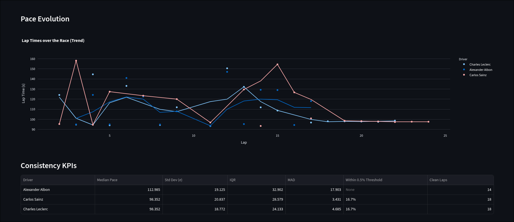

# F1 Race Strategy and Performance Analytics Platform 🏎️📊

[](https://github.com/bonk18/F1-race-analysis/actions)
[](https://www.python.org/downloads/release/python-3110/)
[](https://opensource.org/licenses/MIT)

An end-to-end data engineering, analytics, and machine learning platform for Formula 1 race strategy. 

Built by **Shreyas** ([@bonk18](https://github.com/bonk18)).

## 🌟 Overview

This platform ingests raw telemetry and race-control data from the OpenF1 API, cleans and normalizes it using a bespoke Median Absolute Deviation (MAD) engine, and models tyre degradation and pit-stop outcomes using Gradient Boosting (LightGBM).

The ultimate goal of the platform is to answer the fundamental F1 strategy question:
> **"What is the expected net race time if we pit NOW versus pitting N laps later?"**

## ✨ Features

- **Automated Data Ingestion**: Python-based client that syncs directly with OpenF1, handling API rate limits, caching, and database UPSERT operations.
- **Robust Data Cleaning**: A MAD-based lap classification engine that mathematically isolates pure "race pace" from VSC periods, pit-laps, and statistical outliers.
- **Machine Learning (LightGBM)**: Predicts tyre degradation (lap time decay) with a Mean Absolute Error of **0.275s**, reducing baseline prediction error by 72% by isolating track evolution and fuel burn.
- **Counterfactual Strategy Explorer**: Simulates pit-stop outcomes in real-time, accounting for average pit lane time loss, out-lap pace gains (the undercut), and multi-compound tyre wear.
- **Premium Streamlit Dashboard**: A beautiful, dark-mode interactive web application featuring Plotly data visualizations.

## 📸 Screenshots

| Race Overview | Strategy Explorer |
|:---:|:---:|
|  |  |
| High-level KPIs, podium finishes, and automated text takeaways. | Simulating lap times under different pit-stop scenarios. |

| Tyre Degradation | Driver Pace |
|:---:|:---:|
|  |  |
| Compound-specific degradation rates mapped to Pirelli colors. | Box-plots measuring driver lap time consistency and variance. |

| Pit Strategy Analysis | Data Quality & Cleaning |
|:---:|:---:|
|  |  |
| Analysing pace delta after pit stops. | Transparency into the MAD cleaning engine logic. |

| Cross Race Analysis | Driver Pace Evolution |
|:---:|:---:|
|  |  |
| Comparing pace and pit stops across the season. | LOWESS smoothed pace tracking over a stint. |

## 🚀 Quick Start (Local Environment)

1. **Clone the repository:**
   ```bash
   git clone https://github.com/bonk18/F1-race-analysis.git
   cd F1-race-analysis
   ```

2. **Create and activate a virtual environment:**
   ```bash
   conda create -n f1_strategy python=3.11
   conda activate f1_strategy
   ```

3. **Install dependencies:**
   ```bash
   pip install -r requirements.txt
   ```

4. **Sync Data (e.g., 2024 Bahrain GP):**
   ```bash
   python -m src.ingestion.sync --year 2024 --meeting-key 1229
   ```

5. **Launch the Dashboard:**
   ```bash
   streamlit run dashboard/App.py
   ```

## 🏗️ Architecture

```
F1-race-analysis/
├── dashboard/                 # Streamlit UI & Pages
├── data/                      # Local SQLite Database (f1_strategy.db)
├── sql/                       # Core analytical views
├── src/
│   ├── ingestion/             # OpenF1 Client & DB Loader
│   ├── cleaning/              # MAD Lap Classification Engine
│   ├── analytics/             # KPIs, Race Summary, Undercut detection
│   ├── features/              # ML Feature Engineering Pipeline
│   └── models/                # LightGBM Tyre & Pit Outcome Models
├── tests/                     # Pytest suite
└── requirements.txt
```

## 🧪 Testing

The platform is heavily tested using `pytest`. The test suite uses offline fixture data to ensure reliability independent of the OpenF1 API.

```bash
pytest tests/
```

## 🤝 Contributing

Contributions, issues, and feature requests are welcome! Feel free to check the [issues page](https://github.com/bonk18/F1-race-analysis/issues).

## 📄 License

This project is [MIT](https://opensource.org/licenses/MIT) licensed.
